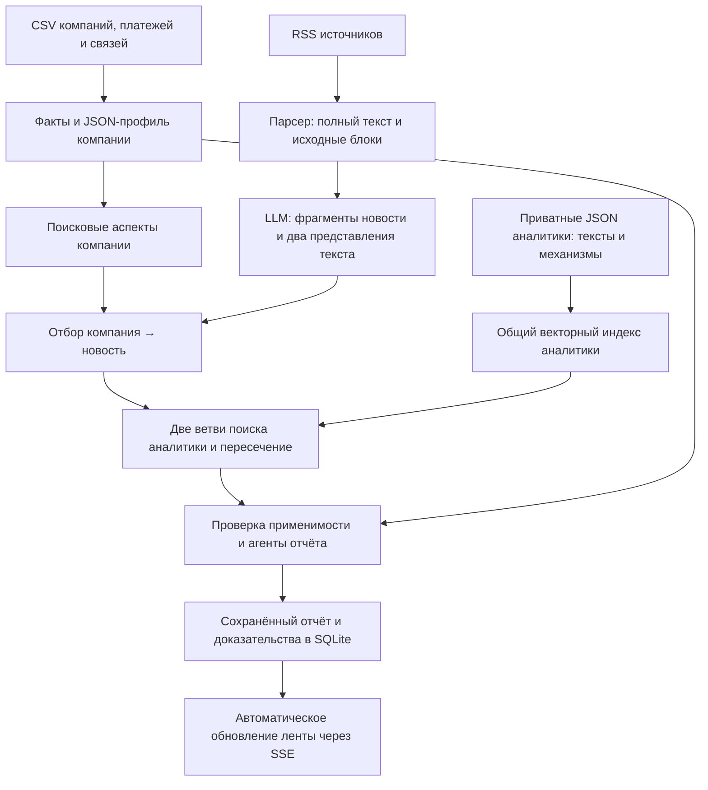
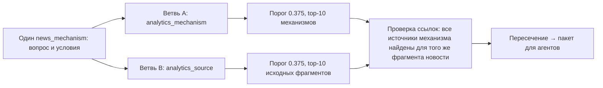

> **Просьба к организаторам от команды «МИДИА».** Пожалуйста, продлите срок действия нашего API-ключа LLM "sk-lMFd…eCRQ".

# Альфа Хак — персональная новостная аналитика для бизнеса

> Версия 1.1.2: публичный Docker-образ содержит программу и EmbeddingGemma,
> а материалы организаторов подключаются из `private-data/` в приватном репозитории.
> Адрес сборки — `ghcr.io/rastok314/alfa-hack-public:1.1.2` (до 5 новостей в отчёте,
> метка «Не является инвестиционной рекомендацией»).
> Образ 1.1.2 опубликован и скачивается без входа в GHCR.

Приложение собирает деловые новости, отбирает события для выбранной компании,
находит подтверждающую аналитику и публикует проверенный LLM отчёт в личном кабинете.
Лента обновляется без перезагрузки страницы; новые результаты появляются по одному.

**Единая точка входа — `app.py`.** Пользовательский сайт — `/`, служебная панель — `/manage`.

[Установка](#быстрый-запуск-готового-образа) ·
[Запуск из исходников](#запуск-из-исходников) ·
[Пять видов векторов](#какие-именно-векторы-формируются) ·
[Добавление компании](#как-добавляется-новая-компания) ·
[Сборка отчёта](#как-собирается-персональный-отчёт).

## Что входит

- Парсер пяти RSS-лент «Коммерсанта» и «Ведомостей» с извлечением полного текста.
- LLM-разметка новости: контекст и запросы для поиска причинных механизмов.
- Локальная **EmbeddingGemma-300m**, нормализованные векторы размерности 768.
- Подбор компания → новость, затем две ветви новость → аналитика и их пересечение.
- Агенты проверки применимости, разбора влияния, синтеза и критики отчёта.
- SQLite: очередь, результаты, версии входов, кеш сравнений и ограниченные повторы ошибок.
- 10 стартовых профилей, 614 подготовленных новостей и 22 аналитических документа в JSON в закрытой папке `private-data/`.
- Стартовая база с четырьмя реальными готовыми отчётами для первого знакомства с лентой.
- Добавление компании по `SYNTHETIC_U` из CSV: готовый профиль используется повторно,
  отсутствующий создаётся из фактов CSV с уточнением аспектов через LLM.
- Обновление финансовых карточек, хранение истории, автоматическая очистка исходных новостей.

Gemma считает векторы **внутри приложения**. Генеративные LLM вызываются через
API организаторов; их веса не входят в поставку. Для работы с новыми публикациями
нужны интернет и действующий API-ключ. Файлы ключа не входят в Git и Docker-образ.

## Быстрый запуск готового образа

Нужны доступ к этому **приватному репозиторию** и собственный ключ LLM.
Docker должен быть запущен с Linux-контейнерами; образ рассчитан на `linux/amd64`.
Публичный образ скачивается без входа в GHCR и без GitHub-токена `read:packages`.
Доступ к репозиторию и скачивание исходников выполняются через ваш GitHub-аккаунт.

**Запускайте проект прямо из скачанной папки репозитория. Создавать отдельную
папку запуска или переносить туда файлы и данные не нужно.**

### Что установить заранее

| ОС | Что нужно |
| --- | --- |
| macOS | [Docker Desktop for Mac](https://docs.docker.com/desktop/setup/install/mac-install/). На Apple Silicon (M1–M4) образ `linux/amd64` работает через эмуляцию: включите **Settings → General → Use Rosetta for x86_64/amd64 emulation on Apple Silicon**. Векторизация при этом идёт медленнее, чем на Intel |
| Linux | Docker Engine и плагин Compose v2 (команда `docker compose`, а не устаревшая `docker-compose`). Если пользователь не входит в группу `docker`, добавляйте `sudo` перед командами Docker или выполните `sudo usermod -aG docker $USER` и перезайдите в систему. На ARM-машинах (`aarch64`) нужна настроенная эмуляция amd64 |
| Windows 10/11 | [Docker Desktop for Windows](https://docs.docker.com/desktop/setup/install/windows-install/) с бэкендом WSL 2 в режиме **Linux containers** (если включены Windows-контейнеры: значок Docker в трее → *Switch to Linux containers*). Команды ниже — для PowerShell |

Проверьте, что Docker запущен (команды одинаковы для всех ОС):

```sh
docker --version
docker compose version
```

### Шаги запуска

1. Скачайте репозиторий через **Code → Download ZIP**, распакуйте архив и откройте
   папку, в которой находится этот `README.md`. Здесь уже лежат
   `compose.bundled.yaml`, `.env.example` и готовая папка `private-data`.
   При использовании `git clone` откройте корень полученной копии репозитория.

   Перейдите в эту папку в терминале и проверьте, что нужные файлы на месте
   (путь замените на свой):

   **macOS / Linux** (Терминал):

   ```sh
   cd ~/Downloads/папка-репозитория
   ls -d compose.bundled.yaml .env.example private-data
   ```

   **Windows** (PowerShell; в Проводнике можно открыть папку и выбрать
   «Открыть в терминале» в контекстном меню):

   ```powershell
   cd "$HOME\Downloads\папка-репозитория"
   Test-Path compose.bundled.yaml, .env.example, private-data
   ```

   Все три проверки должны найти файл (на Windows — три строки `True`).
   Файлы с точкой в начале имени скрыты в Finder (показать: **Cmd+Shift+.**)
   и в большинстве файловых менеджеров Linux (**Ctrl+H**).

2. **В этой же папке** создайте копию `.env.example` с именем `.env`.
   Откройте `.env` текстовым редактором и заполните `LLM_API_KEY` своим ключом.
   Адрес API и названия моделей уже указаны; измените их, если ваш ключ выдан
   для другого адреса или моделей. Сохраните файл. Ключ LLM не является GitHub-токеном.

   **macOS:**

   ```sh
   cp .env.example .env
   open -e .env
   ```

   **Linux** (в `nano` сохранить — Ctrl+O, Enter; выйти — Ctrl+X):

   ```sh
   cp .env.example .env
   nano .env
   ```

   **Windows** (PowerShell):

   ```powershell
   Copy-Item .env.example .env
   notepad .env
   ```

   На Windows создавайте файл командой, а не через Проводник: так он не превратится
   в `.env.txt`. В командной строке `cmd.exe` вместо `Copy-Item` используйте
   `copy .env.example .env`.

3. В том же терминале, **в папке репозитория** рядом с `compose.bundled.yaml`,
   выполните команду. Она одинакова для macOS, Linux и Windows:

   ```sh
   docker compose -f compose.bundled.yaml up -d
   ```

   На Linux без доступа к группе `docker`: `sudo docker compose -f compose.bundled.yaml up -d`.

   Если на Mac с Apple Silicon или на ARM-Linux появляется ошибка
   `no matching manifest for linux/arm64`, явно укажите платформу образа:

   ```sh
   export DOCKER_DEFAULT_PLATFORM=linux/amd64
   docker compose -f compose.bundled.yaml up -d
   ```

4. Откройте **http://127.0.0.1:8765/** в браузере или командой:

   | ОС | Команда |
   | --- | --- |
   | macOS | `open http://127.0.0.1:8765/` |
   | Linux | `xdg-open http://127.0.0.1:8765/` |
   | Windows | `Start-Process http://127.0.0.1:8765/` |

   Выберите компанию в шапке и откройте
   «Новостная аналитика». Для `U_106783` сразу доступны два готовых отчёта,
   для `U_9250` — ещё один (от **25 октября 2026 года**), для `U_14366` —
   отчёт из пяти новостей с тремя карточками (от **26 октября 2026 года**).
   Это реальные ранее сформированные отчёты: даты, источники и выводы сохранены,
   они не выдаются за свежие публикации. Новые отчёты появляются после первичной векторизации
   и обработки через LLM; готовые карточки можно читать во время этой обработки.

Одна команда скачает образ с программой, зависимостями и Gemma и подключит данные
с вашего компьютера. Перед запуском сервера одноразовый сервис `initialize`
скопирует стартовую базу в `runtime`, **только если рабочей базы ещё нет**.
При повторном запуске существующая база, история и векторы сохраняются.
Устанавливать Python, переносить файлы внутрь контейнера
или передавать материалы в реестр образов не нужно. Самих PDF в поставке нет:
тексты страниц, цитаты и механизмы уже сохранены в приватных JSON аналитики.

Ниже показана часть содержимого скачанного репозитория. Эта структура уже готова;
**создать самостоятельно нужно только `.env`**, а `runtime` появится при запуске:

```text
папка-скачанного-репозитория/
├── compose.bundled.yaml
├── .env.example
├── .env                       создаётся вами; содержит ключ LLM
├── private-data/               уже скачана вместе с приватным репозиторием
│   ├── csv/                    3 таблицы организаторов
│   ├── companies/              10 подготовленных профилей
│   ├── analytics/              22 документа JSON аналитики
│   ├── news/                   614 подготовленных новостей
│   └── startup/
│       └── news-analytics.db    чистая стартовая база с 4 готовыми отчётами
└── runtime/                    создаётся автоматически; база и результаты
```

Саму папку репозитория можно назвать как угодно и распаковать в удобное место.
Имена и расположение файлов внутри менять не нужно: пути подключений вычисляются
относительно файла Compose. Папка `private-data`
подключается только для чтения. Результаты, новые профили, векторы и отчёты
записываются в `runtime` и сохраняются после пересоздания контейнера.
Не удаляйте `runtime`, если хотите сохранить ленту и историю обработки.
При обновлении уже работающей установки стартовая база не подменяет вашу:
четыре начальных отчёта автоматически появляются только в новой установке.
Исходные новости старше срока хранения пропускаются; готовые отчёты хранятся
бессрочно вместе со снимками своих источников, поэтому они доступны и при запуске позже.

В `.env` можно изменить `APP_PORT`; открывайте сайт на указанном порту.
Автоматическая обработка включена и использует ваш API-ключ. Для просмотра
интерфейса без автоматических вызовов LLM установите `PIPELINE_AUTO_POLL=0`.
Закрытие вкладки не останавливает приложение.

Команды управления одинаковы для macOS, Linux и Windows; выполняйте их из папки
репозитория (на Linux при необходимости — с `sudo`):

```sh
# Остановить приложение, сохранив данные
docker compose -f compose.bundled.yaml down
# Повторно запустить
docker compose -f compose.bundled.yaml up -d
# Посмотреть журнал работы (выход — Ctrl+C, приложение продолжит работать)
docker compose -f compose.bundled.yaml logs -f app
# Применить изменения .env
docker compose -f compose.bundled.yaml up -d --force-recreate
```

Если папка `private-data` отсутствует, Compose завершится ошибкой подключения,
вместо создания пустой папки. Восстановите её из приватного репозитория.
Исходные JSON и CSV не публикуются вместе с образом и не входят в Docker-слои.

## Запуск из исходников

Нужны Python **3.12 x86-64**, полная локальная папка `google/embeddinggemma-300m`
и ключ API. Все команды выполняются из корня проекта. Веса в Git не хранятся.

В `.env` задайте `EMBEDDING_MODEL_PATH` (путь к папке модели) и `LLM_API_KEY`.
Примеры пути для разных ОС:

```text
macOS:    EMBEDDING_MODEL_PATH=/Users/имя/models/embeddinggemma-300m
Linux:    EMBEDDING_MODEL_PATH=/home/имя/models/embeddinggemma-300m
Windows:  EMBEDDING_MODEL_PATH=C:/models/embeddinggemma-300m
```

На Windows путь можно писать с прямыми слешами `/` — Python понимает такой вариант.

Исходные JSON импортируются при запуске сайта; `init` полезен для отдельной
проверки данных. После `serve` откройте **http://127.0.0.1:8765/**.

### Windows

Установите Python 3.12 (64-bit) с [python.org](https://www.python.org/downloads/windows/)
или через `winget install Python.Python.3.12`. Затем в PowerShell:

```powershell
py -3.12 --version
py -3.12 -m venv .venv
.\.venv\Scripts\python.exe -m pip install -r requirements.txt
Copy-Item .env.example .env
notepad .env
.\.venv\Scripts\python.exe app.py init
.\.venv\Scripts\python.exe app.py serve
```

В командной строке `cmd.exe` вместо `Copy-Item` используйте `copy .env.example .env`,
а интерпретатор вызывайте как `.venv\Scripts\python.exe`.

### Linux

Установите Python 3.12 с модулем `venv`, например:

```sh
# Ubuntu 24.04 / Debian 13
sudo apt install python3.12 python3.12-venv
# Fedora
sudo dnf install python3.12
```

На дистрибутивах без пакета 3.12 используйте `pyenv` или сборку из исходников.
Затем:

```sh
python3.12 --version
python3.12 -m venv .venv
.venv/bin/python -m pip install -r requirements.txt
cp .env.example .env
nano .env
.venv/bin/python app.py init
.venv/bin/python app.py serve
```

### macOS

**Mac на Intel.** Установите Python 3.12 с [python.org](https://www.python.org/downloads/macos/)
или через Homebrew (`brew install python@3.12`), затем:

```sh
python3.12 --version
python3.12 -m venv .venv
.venv/bin/python -m pip install -r requirements.txt
cp .env.example .env
open -e .env
.venv/bin/python app.py init
.venv/bin/python app.py serve
```

**Mac на Apple Silicon (M1–M4).** Проект требует x86-64-интерпретатор, поэтому
проще всего использовать [готовый Docker-образ](#быстрый-запуск-готового-образа).
Для запуска из исходников нужен Rosetta 2 и Python 3.12 с python.org
(универсальный установщик; Homebrew на Apple Silicon ставит только arm64-версию).
Каждую команду Python выполняйте через `arch -x86_64`:

```sh
softwareupdate --install-rosetta --agree-to-license
arch -x86_64 /usr/local/bin/python3.12 -c "import platform; print(platform.machine())"
# должно вывести x86_64
arch -x86_64 /usr/local/bin/python3.12 -m venv .venv
arch -x86_64 .venv/bin/python -m pip install -r requirements.txt
cp .env.example .env
open -e .env
arch -x86_64 .venv/bin/python app.py init
arch -x86_64 .venv/bin/python app.py serve
```

Чтобы не писать `arch -x86_64` перед каждой командой, откройте x86-64-оболочку
командой `arch -x86_64 zsh`: всё, что запущено из неё, работает как x86-64.

### Запуск, панель и остановка

На Windows доступны скрипты:

| Файл | Действие |
| --- | --- |
| `start_interface.cmd` | Запустить сервер или открыть уже работающий сайт |
| `start_management.cmd` | Открыть служебную панель того же сервера |
| `restart_interface.cmd` | Дождаться завершения текущей обработки и перезапустить сервер |
| `stop_interface.cmd` | Дождаться завершения обработки и остановить сервер |

Скрипты используют `.venv` в корне. На macOS и Linux готовых скриптов нет;
используйте команды:

| Действие | macOS | Linux |
| --- | --- | --- |
| Запустить сервер | `.venv/bin/python app.py serve` | `.venv/bin/python app.py serve` |
| Открыть сайт | `open http://127.0.0.1:8765/` | `xdg-open http://127.0.0.1:8765/` |
| Открыть служебную панель | `open http://127.0.0.1:8765/manage` | `xdg-open http://127.0.0.1:8765/manage` |
| Остановить сервер | Ctrl+C в окне сервера | Ctrl+C в окне сервера |

На Mac с Apple Silicon добавляйте `arch -x86_64` перед командой запуска сервера.
При обычном запуске сервер работает, пока открыто его окно терминала;
Ctrl+C завершает сервер.

## Как пользоваться

**Лента.** Выберите компанию. Сервер готовит отчёты только для выбранной компании,
а не для всего списка. Новые карточки приходят автоматически. Фильтры относятся
к готовой ленте, не запускают новый платный анализ.

**Добавление компании.** «Мои компании» → «Добавить компанию» → ID, например
`U_16802` или `16802`. Это значение `SYNTHETIC_U`, не номер строки CSV.
Если компании нет в CSV, показывается ошибка. Повторное добавление не создаёт
копию и не запускает повторную генерацию готового профиля.

Для новых компаний используются три файла в `private-data/csv/`:

```text
df_Uid_data_hack.csv
df_Uid_payment_hack.csv
df_Fid_Uid_link_hack.csv
```

Либо укажите их папку в `DATA_DIR`. В готовом полном образе они уже включены.
Эти CSV включены в приватный репозиторий. Публиковать репозиторий или папку `private-data/` нельзя.

**Служебная панель.** На `/manage` доступны импорт подготовленных JSON, история,
ручной запуск и управление автоматикой. Основной сайт показывает продуктовую
ленту без технических меню сбора.

## Архитектура: от исходных данных к ленте

В системе два отдельных вида моделей. **EmbeddingGemma** локально превращает
подготовленные тексты в векторы и помогает найти кандидатов. **Генеративные LLM**
через API размечают новости, уточняют аспекты компании и проверяют/пишут отчёт.
Само векторное сходство не считается доказательством причинной связи.



**Что подготавливается заранее.** Стартовые профили и аналитические документы
входят в поставку как JSON. В аналитике сохранены исходные текстовые фрагменты,
страницы PDF и извлечённые причинные механизмы со ссылками на эти фрагменты.
Повторная генерация аналитики при каждом добавлении компании не выполняется.
При первом запуске могут потребоваться импорт и первичный расчёт общих векторов.

**Что пополняется в работе.** Парсер опрашивает RSS, получает и очищает полный
текст статьи. Предварительная LLM-разметка выделяет фрагменты с тезисом,
контекстом, исходными цитатами и поисковыми представлениями. Проверенные JSON
импортируются в основную SQLite, затем рассчитываются недостающие векторы.
Парсерская база и основная база разделены: сырая статья ещё не является готовой
карточкой для компании.

### Какие именно векторы формируются

Используются **пять ролей векторов**. Единица индексирования — конкретный
поисковый аспект или фрагмент, а не один вектор на всю компанию или весь PDF.
У одного фрагмента новости может быть два разных вектора.

Например, при разных текстах 12 аспектов компании дают 12 векторов, а статья
с тремя фрагментами — три вектора контекста и до трёх поисковых векторов аналитики.
Точное количество зависит от разметки. Одинаковый текст одной роли может
переиспользоваться несколькими объектами через общую запись в SQLite.

| Роль в SQLite | Из какого поля берётся текст | Способ кодирования Gemma | Для чего используется |
| --- | --- | --- | --- |
| `company_query` | `queries[].text` профиля компании | `encode_query` | Найти события, связанные с конкретным аспектом бизнеса |
| `news_context` | `fragments[].company_embedding_text`: точный тезис и контекст фрагмента | `encode_document` | Сравнение с поисковыми аспектами компании |
| `news_mechanism` | `fragments[].analytics_embedding_text`: поисковый вопрос и условия применимости | `encode_query` | Один и тот же запрос для обеих ветвей аналитического поиска |
| `analytics_source` | `chunks[].embedding_text` подготовленной аналитики | `encode_document` | Поиск по текстовому представлению исходных фрагментов аналитики |
| `analytics_mechanism` | `mechanisms[].embedding_text` подготовленной аналитики | `encode_document` | Поиск по извлечённым причинным механизмам аналитики |

В представлении `news_mechanism` используется `analytics_search_question`,
к которому добавляются условия и границы применимости из `mechanism.context`.
Это вопрос для поиска возможного объяснения, а не уже доказанная причина события.
Если `mechanism.status = not_identified`, поле `analytics_embedding_text` равно
`null`: такой фрагмент не получает вектор для поиска аналитики.

Все рабочие векторы имеют **768 компонент**, тип `float32` и единичную норму.
`encode_query` и `encode_document` используют разные промпты самой модели.
Сходство считается косинусом; для нормализованных векторов это скалярное произведение.
Число вроде `0.40` — значение меры сходства, **не вероятность релевантности**.

SQLite хранит исходный текст, его хеш, роль, метод кодирования, промпт, ревизию
модели, число токенов и сам вектор. Неизменный корректный вектор используется
повторно. Изменение текста, роли или ревизии модели требует соответствующего
нового вычисления. Вход длиннее допустимых 2048 токенов с промптом не обрезается
молча: система требует разделить материал.

Код: [импорт и роли](company-news-analytics/news_analytics/importing.py),
[Gemma и проверка кеша](company-news-analytics/news_analytics/embedding.py).

### Шаг 1. Компания → подходящая новость

У компании есть несколько поисковых аспектов: например, спрос, закупки,
перевозки, финансирование или валютная экспозиция — в зависимости от её данных.
Каждый аспект содержит текст запроса, вес и основания/ограничения.

Векторы `company_query` сравниваются с `news_context` фрагментов новостей
из текущего окна поиска. Для пары аспект–фрагмент рассчитывается:

```text
weighted_score = cosine(company_query, news_context) × weight / max_company_weight
score_news = максимальный weighted_score по аспектам и фрагментам этой новости
```

Это максимум лучшего совпадения, а не среднее всех аспектов. По текущей
конфигурации общий порог — **0.345**, а в подбор попадает до двух фрагментов
на новость. Для оснований `hypothesis` и `partial_payment_evidence` установлен
тот же порог **0.345**; фактическую применимость затем проверяет LLM.
Вместе с совпадением сохраняются аспект, вес, оценка
и конкретный фрагмент, чтобы было видно основание отбора.

Сравнения компания–новость кешируются с учётом версий входов и настроек.
Новый цикл не означает повторную LLM-оценку всего архива. Дубли событий и квота
процентных ставок дополнительно проверяются перед подготовкой платного отчёта.
Все финансовые темы проходят общий отбор; обязательного финансового места нет.

### Шаг 2. Новость → аналитика: две ветви и строгое пересечение

Для каждого выбранного фрагмента берётся его **один `news_mechanism`-вектор**.
Он независимо сравнивается с двумя индексами:



В обеих ветвях сначала применяется порог **0.375**, затем независимый top-10.
В каждой ветви действует ограничение не более двух кандидатов из одного
аналитического документа. Это не один общий список из десяти элементов.

Механизм проходит в пересечение, только если **все** его `source_fragment_ids`
присутствуют среди выбранных источников второй ветви **для того же фрагмента
новости**. Попадания разных фрагментов новости не объединяются в ложное совпадение.
Также проверяется, что текст доказательства соответствует сохранённому источнику.

Учитывается время: аналитика не должна быть опубликована позднее исходной
новости; сейчас допустимый возраст аналитики относительно новости — до 365 дней.
Документы с неизвестной датой не используются для этого поиска.

**Если поддерживающего пересечения нет, новость не отправляется агентам итогового
отчёта.** Её первичная LLM-разметка при этом уже могла потребовать расходов.
Кандидаты вне пересечения сохраняются для диагностики. После первичного допуска
агент при необходимости может запросить дополнительную аналитику из сохранённого
набора кандидатов, но это отдельное рассмотрение с проверкой ссылок.

Код: [оценки и пересечение](company-news-analytics/news_analytics/retrieval.py).

### Как добавляется новая компания

В интерфейсе: **«Мои компании» → «Добавить компанию» → `U_16802` или `16802`**.
Используется идентификатор `SYNTHETIC_U`, а не порядковый номер строки CSV.

1. Сервер нормализует ID и ставит добавление в очередь. Уже выполняющийся запрос
   LLM завершается; отдельная задача не запускает вторую конкурирующую модель.
2. Если профиль уже есть в SQLite, он используется повторно. Если найден готовый
   подходящий JSON в папках входов/загрузок, он валидируется и импортируется.
3. Если JSON нет, код ищет компанию в трёх CSV: сведения о компании, платежи
   и связи с контрагентами. Из доступных полей собираются факты об отрасли,
   регистрации, продуктах, внешней торговле и структуре контрагентов.
   Неизвестные сведения сохраняются как неизвестные, а не додумываются.
4. Код создаёт описание и исходные поисковые аспекты. LLM уточняет аспекты влияния
   по этому описанию и фактам; подходящий кеш уточнения может использоваться
   повторно. LLM не поручается заново выдумывать фактическую часть компании.
5. Формируется и проверяется `company-profile-2.0`: `subject_id`, `profile_text`,
   `facts`, `limitations`, `queries`. У запросов сохраняются вес, категория,
   `evidence_status`, ссылки `source_refs` на факты и допущения `assumptions`.
   Новые предположения модели помечаются гипотезами.
6. Проверенный JSON устанавливается в папку загрузок и импортируется в SQLite.
   Для новой компании рассчитываются только недостающие `company_query`-векторы.
   Уже готовые векторы общего корпуса новостей и аналитики пересчитывать не нужно.
7. После успешного добавления интерфейс выбирает компанию отдельным запросом
   для автоматической обработки.
   Система сравнивает её аспекты с доступными новостями, подбирает аналитику и
   выпускает персональные отчёты по обычной цепочке ниже.


Если ID отсутствует в CSV или обязательная LLM-подготовка не удалась, показывается
ошибка; неполный выдуманный профиль не сохраняется. Если профиль уже импортирован,
но расчёт векторов прервался, повторное добавление продолжит подготовку без
повторной генерации фактов и поисковых аспектов. Первая карточка не гарантируется:
для компании может не оказаться свежей новости с подходящей аналитикой.

Код: [очередь и добавление](src/integration/service.py),
[поиск JSON и CSV](src/integration/onboarding.py),
[сборка профиля](src/integration/profiles.py).

### Как собирается персональный отчёт

При `pipeline.report_mode = deep` итоговая обработка устроена так:

| Этап | Что происходит |
| --- | --- |
| Пакет данных | Код собирает факты компании, выбранную новость и её исходные блоки, аспекты совпадения, аналитические механизмы, цитаты, страницы и доступные рыночные показатели |
| Два мнения | Основная и вторая LLM независимо оценивают применимость новости и каждой связи «новость–аналитика» к компании |
| Арбитраж | При расхождениях и доступном оценочном бюджете основная модель рассматривает оба обоснования; если этот шаг пропущен по бюджету, используется основное мнение, а пропуск фиксируется |
| Проверка оценок | Код проверяет полноту оценок, ID, ссылки на факты и допустимые статусы; незавершённая оценка не считается успешной |
| Разбор новости | Для принятой новости агент описывает канал влияния, условия, риски/возможности и действия; может запросить полный исходный текст, дополнительные сохранённые кандидаты аналитики и историю показателя |
| Синтез | Формируются краткий заголовок, тема, основной вывод, рекомендация и итоговые разделы; отдельные аналитические сценарии помечаются как контекст компании |
| Контроль | Код проверяет ссылки, цитаты, числа, основания и поля интерфейса; при включённом критике и доступном бюджете вторая модель даёт замечания, затем выполняется ограниченная доработка |
| Сохранение и публикация | Валидный `company-report-2.0` преобразуется в результат очереди, сохраняется в SQLite и становится доступен сайту |

Критик и некоторые дополнительные шаги могут быть пропущены по оценочному
предохранителю; параметр `report_budget_rub` не является жёстким ограничением
фактического счёта провайдера. Обязательные проверки кодом не заменяются
успешным ответом модели. Неустранённые структурные ошибки препятствуют публикации.

В каталоге запуска `runtime/reports/<run_id>/` сохраняются входные материалы,
`agent-report.json`, `agent-report.md`, `agent-trace.json` и результат
`llm-result-<id>.json`. Трассировка содержит этапы, модели, токены, расходы
и причины пропусков. SQLite хранит снимки исходных доказательств и статус обработки.
Архив отчётов сохраняется, даже если исходная статья позднее удалена по сроку.

Код: [агенты deep](src/report/deep.py), [пакет данных](src/report/package.py),
[проверки](src/report/verify.py), [сохранение результата](src/integration/adapter.py).

### Когда появляется карточка и что вычисляется повторно

Автоматика работает для выбранной компании экземпляра сервера; один отчёт берёт
**до 5 новостей** (`retrieval.max_total_news` в `config.json`), чтобы одна ложная
находка поиска не обнуляла отчёт. История разных компаний сохраняется отдельно. Сначала могут обрабатываться
уже подготовленные новости, затем новые результаты подготовки поступают в ту же
цепочку. Готовые карточки доставляются через SSE без ручной перезагрузки; при
недоступности SSE клиент повторяет проверку обновлений.

Это не мгновенный push от новостного издателя: по умолчанию RSS проверяется раз
в 60 секунд. Затем нужны загрузка статьи, первичная разметка, поиск и агентские
вызовы. Поэтому время появления карточки включает ожидание источника и очередь LLM;
само сравнение готовых векторов не означает вызов генеративной модели.

Неизменные векторы и сравнения используются повторно. У завершённых партий,
включая аргументированное отклонение, сохраняется память обработки; они не должны
без причины возвращаться к итоговой LLM в каждом цикле. Изменения входных версий
могут потребовать нового сравнения. Ошибки имеют сохранённые причины и ограниченные
повторы. Для метки «Процентные ставки» действует общий лимит: одна обработка на
компанию за 12 часов. Эксперимент с подавлением дублей по векторам главных тезисов
в рабочем цикле отключён.

[Подробности модулей и хранения](docs/ARCHITECTURE.md) ·
[Квота процентных ставок](docs/INTEREST_RATE_QUOTA.md).

## Основные настройки

| Параметр `config.json` | Значение | Значение для работы |
| --- | --- | --- |
| `pipeline.interval_seconds` | 60 | Интервал проверки источников, секунды |
| `retrieval.news_days` | 7 | Возраст новостей для нового подбора |
| `pipeline.news_retention_days` | 10 | Хранение исходных новостей |
| `retrieval.min_news_score` | 0.345 | Порог компания → новость |
| `retrieval.min_analytics_score` | 0.375 | Порог аналитического поиска |
| `retrieval.analytics_per_news` | 10 | Кандидаты аналитики на ветвь |
| `pipeline.report_mode` | `deep` | Текущая схема агентов |
| `pipeline.report_budget_rub` | 20 | Оценочный предохранитель необязательных шагов, не жёсткий лимит счёта API |

Для слабых оснований профиля установлен тот же порог 0.345
(`admission.min_weak_news_score`). Финансовые новости проходят общий отбор,
отдельного обязательного места для них нет. Готовые отчёты хранятся бессрочно;
удаление старой исходной статьи не удаляет опубликованный отчёт.

Для метки **«Процентные ставки»** действует отдельное ограничение: не более одного
материала на компанию за 12 часов (`admission.interest_rate_interval_hours`).
Оно проверяется перед генерацией отчёта и включает прогнозы и комментарии,
а не только решения ЦБ. Накопившиеся карточки внутри одного такого интервала
показываются одной, с последним текстом; исходные отчёты сохраняются.
[Подробности ограничения](docs/INTEREST_RATE_QUOTA.md).

[Настройки и хранение](docs/NEWS_RETENTION.md) · [Архитектура](docs/ARCHITECTURE.md).

## Команды

Ниже `python` — интерпретатор установленного окружения. Чтобы команда `python`
указывала на `.venv`, активируйте окружение в корне проекта:

| ОС / оболочка | Активация |
| --- | --- |
| macOS, Linux | `source .venv/bin/activate` |
| macOS на Apple Silicon | сначала `arch -x86_64 zsh`, затем `source .venv/bin/activate` |
| Windows, PowerShell | `.\.venv\Scripts\Activate.ps1` |
| Windows, cmd.exe | `.venv\Scripts\activate.bat` |

Если PowerShell запрещает запуск скрипта активации, разрешите его для текущего окна:
`Set-ExecutionPolicy -Scope Process -ExecutionPolicy Bypass`. Без активации
вызывайте интерпретатор полным путём: `.venv/bin/python` на macOS и Linux,
`.\.venv\Scripts\python.exe` на Windows. Выйти из окружения — `deactivate`.

```sh
python app.py status
python app.py import --news path/to/prepared-json
python app.py embed
python app.py compare --company U_9250
python app.py generate --company U_9250 --top-news 1
python app.py history --company U_9250
python app.py cleanup --dry-run
python app.py company-from-csv --company U_16802 --csv-dir data --refine
```

`compare` сохраняет подбор и вход для отчёта; `generate` вызывает LLM и завершает
проверенную партию. Для диагностики API: `python app.py check --llm` — один короткий
платный запрос. Для отдельно запущенного фонового процесса: `python app.py worker`.
Не запускайте `worker` одновременно с автоматикой веб-сервера на той же базе.

## Данные и структура

```text
app.py                        единый запуск
config.json                   пути и параметры
src/integration/              соединение модулей, HTTP, лента и интерфейс
src/parser/                   RSS и извлечение текста
src/company_profile/          факты компании и аспекты поиска
src/news_prep/                LLM-разметка новостей
src/report/                   агенты итогового отчёта
src/llm/                      клиент API, кеш и учёт вызовов
company-news-analytics/        импорт, векторы, поиск и долговечная очередь
tests/                        интеграционные проверки
tools/                        запуск, проверка и упаковка
runtime/                      рабочие БД, отчёты и кеши; вне Git
private-data/                 CSV, профили, новости и JSON аналитики; только приватный Git
```

`runtime/news-analytics.db` — основная база. `runtime/parser/news.db` — база сырых
статей. `runtime/reports/<run_id>/` содержит отчёт агентов, трассировку и результат
для сайта. `runtime/llm-cache/calls.jsonl` содержит статистику вызовов.
Нельзя просто копировать работающую SQLite вместе с незавершённым WAL для переноса:
используйте штатный SQLite backup или остановите обработку перед копированием.

## Проверки

```sh
python -m pip install -r requirements-test.txt
python -m pip check
python -m unittest discover -s tests -p "test_*.py" -v
python -m unittest discover -s src/parser/tests -p "test_*.py" -v
```

Отдельно из `company-news-analytics/`:

```sh
python -m unittest discover -s tests -p "test_*.py" -v
python tools/validate_inputs.py
```

При установленном Node.js:

```sh
node tests/test_live_client.cjs
node tests/test_company_onboarding_client.cjs
node tests/test_report_presentation.cjs
node tests/test_currency_widget.cjs
```

Тесты используют временные базы и подставные ответы LLM. Проверка настоящей Gemma
без вызовов API: `python tools/smoke_model.py` с доступными моделью и тремя CSV.
[Результаты проверки поставки](docs/RELEASE_CHECKS.md).

## Ограничения

Это приложение хакатона, не банковский сервис платежей. Счета, заявки и часть
навигации в макете иллюстративны; они не подключены к банковским операциям.
Курсы валют загружаются отдельным виджетом из публичного источника Альфа-Банка.

Доступность полных статей, скорость API и бюджет команды влияют на скорость ленты.
Статья за пейволлом не становится полной автоматически. Новость может не пройти
пороги или проверку аналитики — непрерывный выпуск карточек не гарантируется.
Встроенной авторизации пользователей нет: стандартный Docker-запуск доступен
только на localhost; для публичного размещения необходим отдельный защищённый вход.

## Источники и лицензии

[Источники, материалы и лицензии](THIRD_PARTY_NOTICES.md).

Условия использования Gemma: https://ai.google.dev/gemma/terms.
В образе с Gemma копия условий и Notice находятся в `/licenses/gemma/`.
