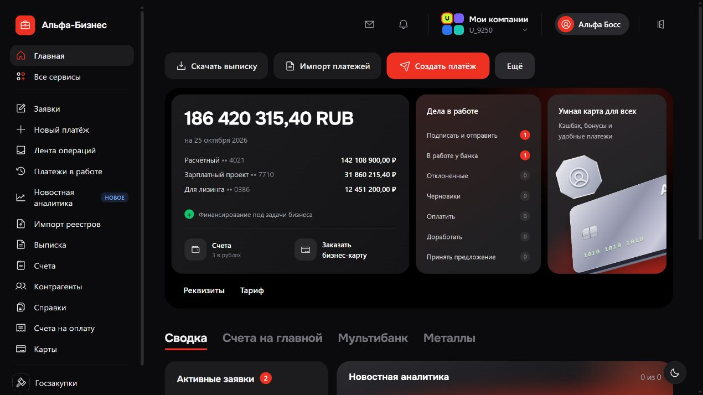
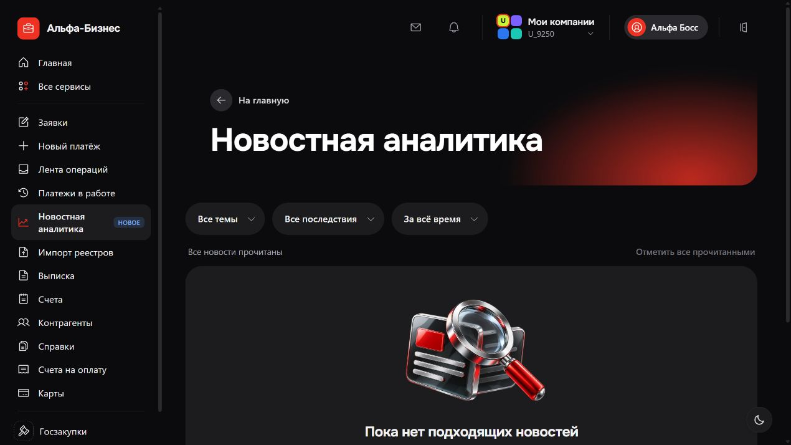

# Проверка поставки 1.1.0 — 26 октября 2026

Новая поставка разделяет публичный образ и приватные материалы.

Первый запуск GitHub Actions прошёл в Linux и Docker; на Windows обнаружено
чтение русского JSON в тесте с системной кодировкой cp1252. Тест исправлен:
`Path.read_text(encoding='utf-8')`. Проверка с принудительной cp1252 и основной
набор из 142 тестов проходят. Для русских диагностических сообщений парсера
в окружении CI явно задан UTF-8 (`PYTHONUTF8=1`, `PYTHONIOENCODING=utf-8`).
Тест загрузки сравнивает идентичность сохранённого файла через `samefile`,
поскольку Windows может обозначать одну папку именами `runneradmin` и `RUNNER~1`.
Рабочий код приложения и Docker-образ не менялись.
Текущие результаты CI для ветки проверяются в GitHub Actions перед объединением.

| Проверка | Результат |
| --- | --- |
| Основной набор Python | 142 теста, успешно |
| Модуль аналитики | 84 теста, успешно |
| Полный импорт приватного комплекта | 3 CSV, 10 профилей, 614 новостей, 22 JSON аналитики; без ошибок |
| Исходные PDF | Не входят в новую поставку и не требуются для импорта |
| Linux-контейнер с подключёнными данными | Сайт отвечает 200; 10 компаний, 22 аналитики |
| Возраст начальных новостей | Обычная очистка оставляет только актуальные; на момент проверки 265 |
| Папка запуска с кириллицей и пробелами | Compose корректно находит private-data относительно файла |
| Приватная папка | Подключена только для чтения; исходные файлы не изменены |
| Перезапуск контейнера | Выбранная компания сохраняется в runtime |
| Тот же образ без подключения данных | 0 компаний, 0 новостей, 0 аналитик |
| Настоящая EmbeddingGemma в Linux без сети | 15 векторов, 768 измерений; при перезапуске повторно использованы все 15 |
| Вызовы платного API в этих проверках | 0 |

Все Docker-слои нового архива проверяются инструментом `tools/verify_public_image.py`.
Протокол, контрольные суммы, идентификатор и результаты проверки опубликованного
образа фиксируются отдельными файлами в комплекте сдачи. На этом этапе новый
образ загружен в GHCR, авторизованное скачивание и digest проверены.
Анонимный запрос пока получает HTTP 401: пакет приватный, владелец включает публичность самостоятельно.
Git commit и push не выполнены.

Рабочая папка разработчика, прежняя база, отчёты и приватные образы 1.0.x
не изменялись. Ниже сохранён исторический протокол предыдущей версии; сведения
о PDF/CSV внутри образа относятся только к ней.

---

# Проверка поставки 1.0.1 — 26 октября 2026

Ниже приведены проверки исходной поставки и регрессии исправления.
Обновлённая сборка 1.0.1 содержит ту же Gemma, CSV и зависимости, а также
исправленную квоту. Результаты её контейнерных проверок, идентификатор и SHA-256
записаны в файлах `rebuild-1.0.1-verification.json` и `image-info.json` комплекта.
Проверены рабочие исходники и Linux-образ. Производственная БД разработчика
не использовалась для тестовых записей. Для тестов создавались временные базы;
контейнерный сайт работал с отдельным томом и выключенной автоматикой.

## Результаты

| Проверка | Результат |
| --- | --- |
| Основной набор Python на Windows | 131 тест, успешно |
| Модуль поиска на Windows | 84 теста, успешно |
| Парсер на Windows | 26 тестов, 4 платформенных пропуска, остальные успешны |
| Основной набор Python в Linux-контейнере | 131 тест, успешно |
| Модуль поиска в Linux-контейнере | 84 теста, успешно |
| Парсер в Linux-контейнере | 26 тестов, успешно, без пропусков |
| JS: лента, добавление компании, отчёты, валюты | Все 4 набора успешно |
| `pip check` в локальном окружении и образе | Конфликтов нет |
| Входные JSON | 10 компаний, 614 новостей, 22 аналитических документа; отклонений нет |
| Оригиналы аналитики | 22 PDF, SHA-256 совпадают |
| Настоящая Gemma, без сети | 15 векторов компании, размерность 768, корректная нормализация |
| Повторная загрузка сервиса на той же временной БД | 15 векторов использованы повторно, новых вычислений 0 |
| SQLite | Проверка целостности успешна |
| CSV в полном образе | Все 3 файла доступны, содержат записи |
| HTTP и браузер | Главная, лента, пустое состояние, список компаний и медиа доступны |
| Контейнерный перезапуск | Выбранная компания сохранена в томе |
| Неизвестный ID компании | Контролируемая ошибка, неполный профиль не создаётся |
| Ключ API | Один короткий успешный запрос с хоста и один из контейнера |
| Модели API | MAIN, FAST и SECOND присутствуют в списке провайдера |
| История Git | Проверены 7 исходных коммитов; характерные форматы ключей не найдены |

В двух коротких проверках API использовано 63 токена суммарно. Это расход именно
проверок соединения, не всего работающего приложения. Ключ в отчёт не включён.
Полные агентские отчёты в автоматических тестах используют подставные ответы;
отдельный полный новый многоагентный отчёт в контейнере в рамках этой проверки
не оплачивался. Проверка доступа FAST не является гарантией доступности остальных
моделей в любой последующий момент.

## Исправлено при подготовке

- Устаревший тест полного совпадения со старым HTML заменён проверкой исходного
  CSS, сохранности стабильных элементов, уникальности ID и ссылок SVG.
- Метаданные HTML возвращены внутрь `head`.
- Правило Git для `data/` ограничено корневой папкой CSV: новые стартовые профили
  и аналитические PDF не теряются при добавлении в индекс.
- Полный образ дополнен CSV; Compose использует контейнерные пути.
- CI запускает образ без ключа с выключенной автоматикой и проверяет JS.
- Транзитивная зависимость `hf-xet` закреплена, базовый Python-образ закреплён digest.
- Секреты, состояния, эксперименты и превью отделены от исходной поставки.

## Границы проверки

Проверка не означает полного отсутствия дублей и ошибок LLM. Подбор зависит от
источников, возраста публикаций, порогов и наличия подходящей аналитики.
Не проводилось испытание публичного многопользовательского хостинга, ARM-образа
и массовой параллельной нагрузки. Стандартная поставка предназначена для
локального запуска Linux/amd64; публичному серверу нужен защищённый вход.

Образ 1.0.1 опубликован приватно в `ghcr.io/rastok314/alfa-hack:1.0.1`;
авторизованное скачивание проверено. Архивы исходников в Git не опубликованы.
Итоговые размеры, SHA-256 и идентификатор образа
записываются рядом с комплектом после экспорта. `submission-manifest.json`
фиксирует состав исходников; `tools/verify_submission.py` проверяет его.

## Исправление квоты — 26 октября 2026

Добавлена общая квота метки «Процентные ставки»: один материал на компанию за
12 часов перед генерацией отчёта; архивные карточки за этот интервал объединяются.
Проверены ручная партия, завершение старого пакета, отклонённый отчёт, истечение
12 часов, независимость компаний, перезапуск, удаление статьи и смена профиля.
Основной набор: 142 теста, успешно; модуль поиска: 84 теста, успешно. Новые
11 регрессионных проверок не вызывают платный API. На копии настоящей базы
U_16802 семь карточек отображаются одной; целостность SQLite — ok.

Исправление включено в образ 1.0.1, его архив и приватный тег GHCR.
Прежний образ 1.0.0 оставлен без изменения. Скачивание новой версии проверено;
digest и результаты публикации записаны в publication-status.json комплекта.
Рабочие файлы приложения не менялись после контейнерных проверок; обновлены
инструкция скачивания, настройки Compose и метаданные соответствия исходникам.

## Внешний вид из контейнера

